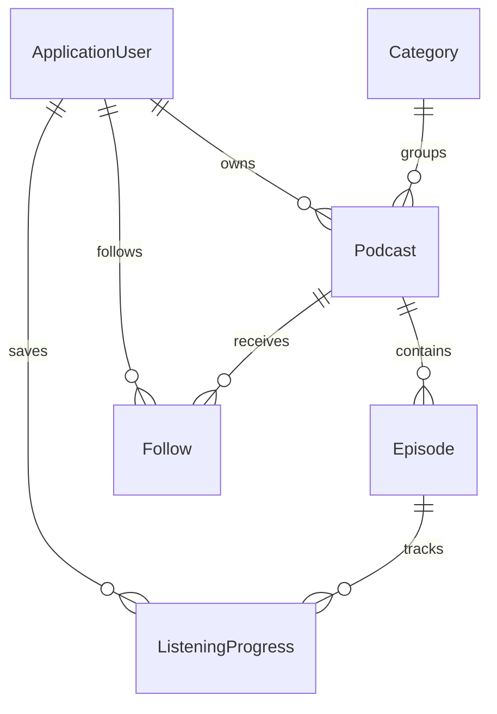

# Начална база

ApplicationUser използва Identity ключ string. Другите домейн IDs са int. Follow има съставен ключ UserId/PodcastId; Progress — UserId/EpisodeId. Category.Name е уникално. PositionSeconds е неотрицателно. Проверка спрямо реална продължителност и правило за публикуване с валидно аудио ще се добавят с бизнес логиката. Началната база се създава локално с EF migration; генерираните migration/snapshot са в GoSound/Migrations, SQL схемата е в docs/GoSound_InitialSchema.sql. Прилагането към твоя SQL Server се изпълнява локално.
